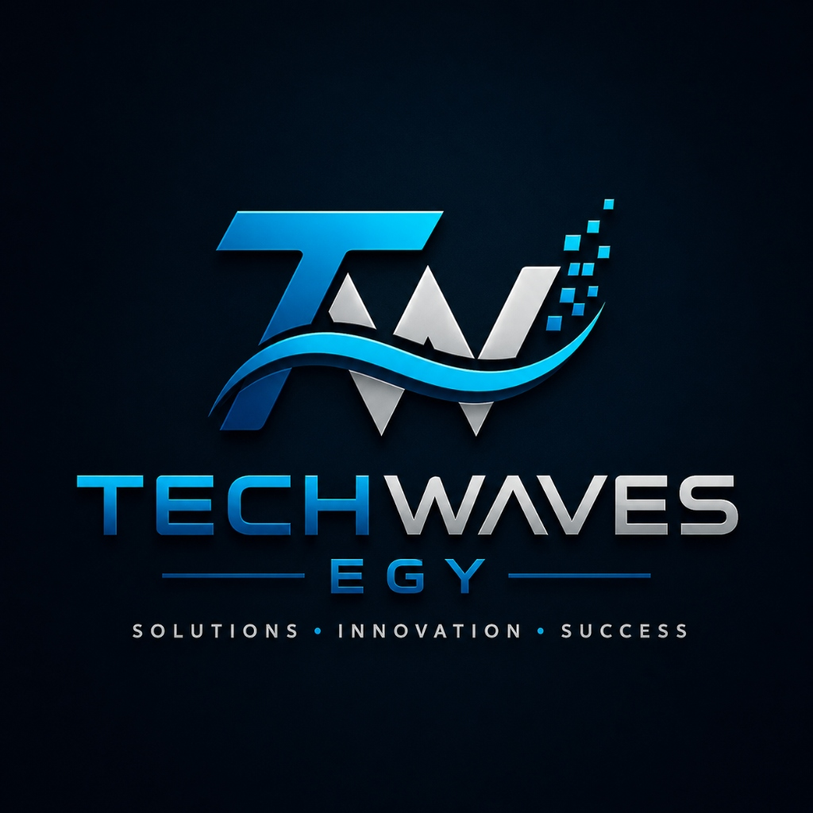
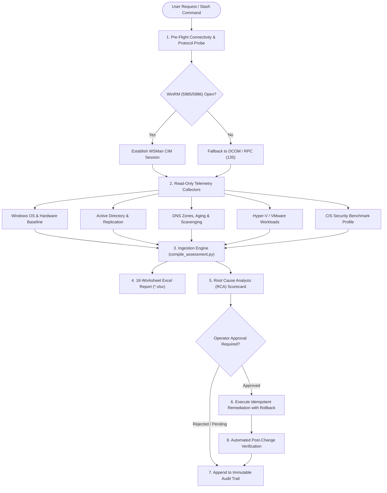

<p align="center">
  
</p>

<h1 align="center">Enterprise Infrastructure Operations &amp; Health-Check Center of Excellence (CoE)</h1>

<p align="center">
  <strong>Techwaves EGY</strong> — <em>SOLUTIONS • INNOVATION • SUCCESS</em><br/>
  Contact: <a href="mailto:info@techwaves-egy.com">info@techwaves-egy.com</a>
</p>

<p align="center">
  <a href="https://learn.microsoft.com/en-us/windows-server/"></a>
  <a href="https://learn.microsoft.com/en-us/windows-server/identity/ad-ds/active-directory-domain-services"></a>
  <a href="https://learn.microsoft.com/en-us/windows-server/virtualization/hyper-v/hyper-v-technology-overview"></a>
  <a href="https://www.vmware.com/products/vsphere.html"></a>
  <a href="#-18-worksheet-reporting-architecture"></a>
  <a href="#-universal-agent-installation--setup"></a>
  <a href="LICENSE"></a>
</p>

An enterprise-grade, multi-agent AI skill and operational framework designed to discover, audit, benchmark, monitor, and optimize hybrid mission-critical infrastructure across **Windows Server (2016–2025)**, **Active Directory Domain Services (AD DS)**, **DNS / DHCP**, **Hyper-V Failover Clusters (CSV)**, and **VMware vSphere (vCenter 7.x/8.x &amp; ESXi)**.

---

## 🏛️ Architecture & Operating Model

The framework functions as an automated **Senior Infrastructure Operations &amp; Health-Check Specialist**, operating through a strict 9-layer technology stack:

```
[ Layer 1: Client / Jumpbox Workstation (PowerShell Core, Python 3, RSAT, PowerCLI) ]
                                          ↓
[ Layer 2: Network Adjacency & Security Boundaries (ICMP, RPC 135, SMB 445, WinRM 5985/5986) ]
                                          ↓
[ Layer 3: Remote Host Discovery Pipeline (Auto-Negotiation: WSMan / CIM / DCOM / WMI) ]
                                          ↓
[ Layer 4: Directory Services Tier (Active Directory DS, Kerberos KDC, LDAP/LDAPS, DNS, DHCP) ]
                                          ↓
[ Layer 5: Virtualization & Hypervisor Tier (Failover Clustering, Hyper-V CSV, VMware vSphere/ESXi) ]
                                          ↓
[ Layer 6: Enterprise Storage & Data Protection Tier (SAN/NAS LUNs, Datastores, Backup Heartbeat) ]
                                          ↓
[ Layer 7: Cybersecurity & Hardening Baseline (CIS Benchmarks, LDAP Signing, Channel Binding) ]
                                          ↓
[ Layer 8: Assessment Synthesis & Ingestion Engine (Multi-Host Telemetry JSON, Schema Validation) ]
                                          ↓
[ Layer 9: Executive & Technical Reporting (18-Worksheet Excel Workbook, RCA, Remediation Playbooks) ]
```



---

## 🛡️ Core Operating Principles & Safety Model

1. **Strict Read-Only Discovery**: Zero modifications or state changes are permitted during health assessments or diagnostic sweeps.
2. **Explicit Approval Gate**: Autonomous execution of remediations is strictly prohibited. Every action requires explicit operator approval citing the specific **Issue ID** (e.g., `Approve ISSUE-SEC-001`).
3. **Rollback Assurance**: Every remediation playbook is strictly idempotent and paired with an automated, verified rollback command.
4. **Zero Secret Exposure**: Passwords, tokens, Kerberos keys, and credentials are never stored in plain text, logged in audit trails, or committed to version control. Passwords exist solely in memory via `PSCredential` / `SecureString`.
5. **Immutable Audit Trail**: All operations, collector runs, approvals, and validations are recorded in `audit/session_audit.log` and `audit/changes.jsonl`.

---

## 📊 18-Worksheet Reporting Architecture

Every full infrastructure assessment synthesizes telemetry into a comprehensive 18-worksheet Excel workbook:

| # | Worksheet Name | Scope & Telemetry Focus |
|---|----------------|-------------------------|
| 1 | **Executive Summary** | Fleet health index, severity rollup (Critical/High/Medium/Low), critical blockers |
| 2 | **Scorecard & KPI** | Subsystem compliance scores across compute, memory, storage, AD, and hypervisors |
| 3 | **System & OS Baseline** | Hardware vendor, CPU cores/sockets, RAM utilization, boot time, uptime days |
| 4 | **Active Directory DS** | Forest/domain functional levels, AD Recycle Bin state, site subnets |
| 5 | **Domain Controllers & FSMO** | DC inventory, 5 FSMO roles distribution, Global Catalog placement |
| 6 | **AD Replication & SYSVOL** | DFSR replication health, SYSVOL/Netlogon share accessibility, replication latency |
| 7 | **DNS Server & Zones** | AD-integrated forward/reverse zones, forwarders, aging & scavenging intervals |
| 8 | **DHCP Server & Scopes** | Subnet scopes, IP exhaustion risk, failover partner synchronization |
| 9 | **Failover Clustering** | Cluster quorum, witness disk/share, node state, heartbeat routing |
| 10 | **Hyper-V Infrastructure** | Virtual switches, 10G migration interconnect, CSV Block Cache, power plan |
| 11 | **Hyper-V Virtual Machines** | VM states, vCPU allocations, dynamic RAM, checkpoints, mounted ISO locks |
| 12 | **VMware vCenter Health** | VCSA appliance health, build versions, single sign-on (SSO), vCenter alarms |
| 13 | **VMware ESXi Hosts** | Host readiness %, memory ballooning/swapping, DRS/HA events, maintenance state |
| 14 | **Enterprise Storage & LUNs** | CSV volumes, VMFS datastores, IOPS latency, free space percentages (< 15% alert) |
| 15 | **Backup & DR Posture** | Enterprise backup agent heartbeat, SLA adherence, aged snapshots (> 72 hours) |
| 16 | **Security & CIS Hardening** | Print Spooler on DCs, LDAP signing, Channel Binding, Protected Users, SMBv1 |
| 17 | **Root Cause Analysis (RCA)** | Formal RCA table with Probable Root Cause, Impact, Confidence, and Risk |
| 18 | **Remediation Action Plan** | Prioritized runbooks, pre-requisites, rollback plans, and approval check-boxes |

---

## 🚀 Universal Agent Installation & Setup

### 1. Google Antigravity
The skill is natively discovered via `skills/infrastructure-health/SKILL.md`. Simply prompt:
```text
Run infrastructure health check on 10.0.0.10 with user Administrator and password <pass>
```
Or execute the slash command:
```text
/infrastructure-health
```

### 2. Claude Code
Point Claude Code to the repository or copy `skills/infrastructure-health` into your Claude skills directory:
```bash
claude "Read CLAUDE.md and execute remote health discovery against target 192.168.1.10"
```

### 3. Cursor & Windsurf
Place the repository in your workspace. Both `.cursorrules` and `.windsurfrules` automatically enforce the read-only safety model, explicit approval gates, and 18-worksheet Excel synthesis.

---

## 💻 Manual CLI & Collector Usage

### 1. Remote Windows Server & Domain Controller Health Check
```powershell
powershell -NoProfile -ExecutionPolicy Bypass -File "scripts/collectors/Invoke-RemoteHostDiscovery.ps1" `
  -TargetIP "192.168.1.10" `
  -Username "DOMAIN\Administrator" `
  -Password "SecretPassword"
```

### 2. Hyper-V Cluster & Workload Discovery
```powershell
powershell -NoProfile -ExecutionPolicy Bypass -File "scripts/collectors/Invoke-HyperVClusterDiscovery.ps1" `
  -Targets "192.168.1.20", "192.168.1.21" `
  -Username "DOMAIN\ClusterAdmin" `
  -Password "SecretPassword"
```

### 3. CIS Windows Server Benchmark Audit
```powershell
powershell -NoProfile -ExecutionPolicy Bypass -File "scripts/collectors/Invoke-CISBenchmarkAudit.ps1" `
  -TargetIP "192.168.1.10" `
  -Username "DOMAIN\Administrator" `
  -Password "SecretPassword"
```

### 4. Compile Assessment & Excel Report
```bash
python scripts/compile_assessment.py
```

---

## 📚 Standard Hardening Playbooks

| Playbook | Target Vulnerability / Issue | Recommended Remediation | Rollback Path |
| :--- | :--- | :--- | :--- |
| [`Print-Spooler-Remediation.md`](playbooks/Print-Spooler-Remediation.md) | PrintNightmare (CVE-2021-34527) on Domain Controllers | Stop & Disable `Spooler` service | Enable & Start `Spooler` |
| [`Active-Directory-Hardening.md`](playbooks/Active-Directory-Hardening.md) | Cleartext LDAP & NTLM relay attacks | Enforce LDAP Signing (2) & Channel Binding (2) | Reset registry to Level 1 |
| [`Active-Directory-Hardening.md`](playbooks/Active-Directory-Hardening.md) | Accidental object deletion | Enable Active Directory Recycle Bin | Permanent by design |
| [`DNS-Scavenging-Configuration.md`](playbooks/DNS-Scavenging-Configuration.md) | Stale DNS records & IP collisions | Enable Server & Zone Scavenging (7 days) | Disable aging on zone |
| [`Hyper-V-Failover-Optimization.md`](playbooks/Hyper-V-Failover-Optimization.md) | CSV storage read latency & I/O bottlenecks | Allocate CSV Block Cache (2048 MB) | Set BlockCacheSize = 0 |

---

## 🔒 Security & Privacy Statement

This repository contains **zero client data, credentials, or production telemetry**. All collectors are designed to ingest credentials strictly in memory via PowerShell `[PSCredential]` objects and sanitize all outputs prior to disk persistence. The `.gitignore` policy strictly excludes all operational caches, discovery JSON files, and generated Excel workbooks.

---

## 📄 License & Attribution

Copyright (c) 2025–2026 **Techwaves EGY** / **Waleed Talaat**. All rights reserved.  
Licensed under the terms of the [Proprietary Software License](LICENSE) and [End User License Agreement](EULA.md).  
For commercial engagements and consulting inquiries, contact: **info@techwaves-egy.com**.
