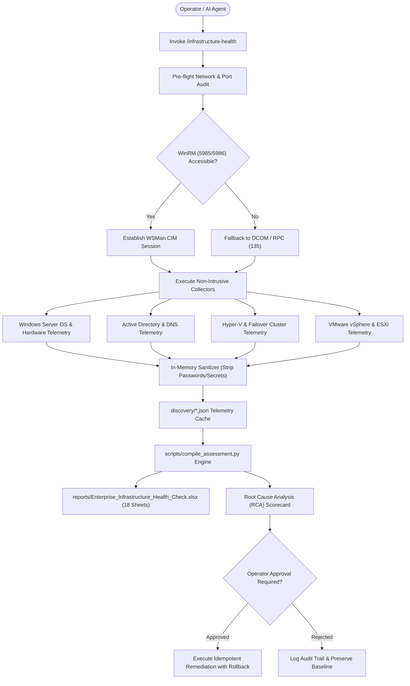

# Enterprise Infrastructure Expert — Architecture & Technology Stack

```
[ Layer 1: Client & Jumpbox Workstation (PowerShell Core, Python 3, RSAT, PowerCLI) ]
                                          ↓
[ Layer 2: Network Adjacency & Security Boundaries (ICMP, RPC 135, SMB 445, WinRM 5985/5986) ]
                                          ↓
[ Layer 3: Remote Host Discovery Pipeline (Auto-Negotiation: WSMan / CIM / DCOM / WMI) ]
                                          ↓
[ Layer 4: Directory Services Tier (Active Directory DS, Kerberos KDC, LDAP/LDAPS, DNS, DHCP) ]
                                          ↓
[ Layer 5: Virtualization & Hypervisor Tier (Failover Clustering, Hyper-V CSV, VMware vSphere/ESXi) ]
                                          ↓
[ Layer 6: Enterprise Storage & Data Protection Tier (SAN/NAS LUNs, Datastores, Backup Heartbeat) ]
                                          ↓
[ Layer 7: Cybersecurity & Hardening Baseline (CIS Benchmarks, LDAP Signing, Channel Binding) ]
                                          ↓
[ Layer 8: Assessment Synthesis & Ingestion Engine (Multi-Host Telemetry JSON, Schema Validation) ]
                                          ↓
[ Layer 9: Executive & Technical Reporting (18-Worksheet Excel Workbook, RCA, Remediation Playbooks) ]
```

## Telemetry Pipeline Architecture


